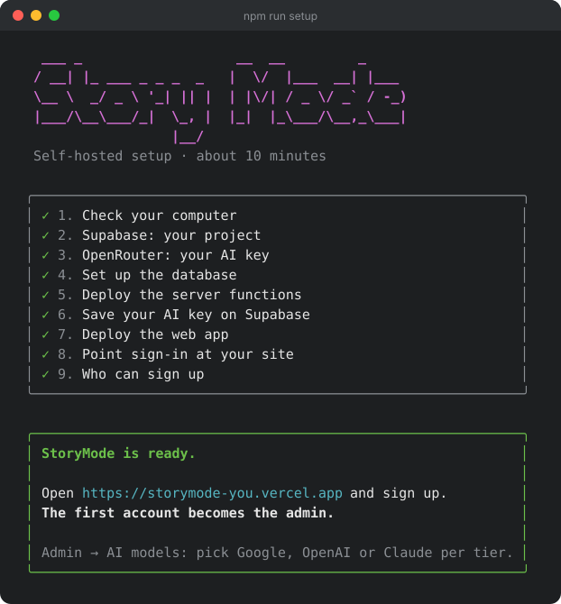

# StoryMode setup guide

More detail than the [README](README.md) has room for: what each setup step
does, who can sign up, and fixes for common problems. Where to find each key
is in the README's [setup steps](README.md#how-to-set-it-up).

## What the setup wizard does

`npm run setup` walks you through nine steps and checks each answer before
moving on:

<p align="center">
  
</p>

1. **Check your computer**: Node.js, npx, git and your internet connection.
2. **Supabase**: checks your access token, lets you pick your project (and waits while a new one starts up), and checks your database password.
3. **OpenRouter**: checks your key and warns you if there's no credit yet.
4. **Set up the database**: tables, storage and security rules.
5. **Deploy the server functions.**
6. **Save your AI key on Supabase**, where only the server can read it.
7. **Deploy the web app** with the Vercel CLI (it signs you in through your browser), or gives you the two values to deploy it anywhere.
8. **Point sign-in at your site**, so sign-up emails link to it.
9. **Who can sign up**: just you, people you add, or anyone you open sign-ups to. Only the last one needs Resend ([more below](#who-can-sign-up)).

> [!TIP]
> Your secrets are never shown as you type and never saved on your computer.
> If you stop halfway, run `npm run setup` again: it picks up where you left off.

<details>
<summary><b>Prefer the Vercel button?</b></summary>

<br>

Run `npm run setup` and choose **I'll deploy it myself** when it asks; it
prints the two values. Then:

[](https://vercel.com/new/clone?repository-url=https%3A%2F%2Fgithub.com%2Fsakhnenko%2Fstorymode-community&env=VITE_SUPABASE_URL,VITE_SUPABASE_PUBLISHABLE_KEY&envDescription=Both%20values%20are%20printed%20by%20npm%20run%20setup&project-name=storymode&repository-name=storymode)

Paste the values, deploy, and give the wizard your site's address.

</details>

## Who can sign up

Everyone with an account can use AI on your OpenRouter credit, so **sign-ups
start closed**. The first account (you, the admin) can always sign up. After
that, only the addresses you add in **Admin → Sign-ups** can, until you switch
it to **Anyone**.

Your choice also decides whether you need an email service, since Supabase's
built-in email only reaches the address you use for supabase.com:

| Who will use it | Email | How people join |
|---|---|---|
| **Just me** | Supabase's built-in email | Sign up with your Supabase account's email. |
| **Me and a few people I add** | None: accounts work without confirming | Add their address in **Admin → Sign-ups**; they sign up on your site. Nobody can reset a forgotten password. |
| **Anyone I open sign-ups to** | [Resend](https://resend.com) | Switch **Admin → Sign-ups** to **Anyone** when you're ready. |

The setup wizard asks which one. To change your mind later, run `npm run setup`,
choose **Start over**, and pick another option at the last step.

## How it fits together

```
  writers ──▶ Vercel                the web app
                │
                ▼
              Supabase
                ├─ Postgres         projects, chapters, notes, maps
                ├─ Auth             sign-in ──▶ Resend (emails)
                ├─ Storage          map stickers and pictures
                └─ Edge Functions   AI requests ──▶ OpenRouter
                                                      ├─ Google
                                                      ├─ OpenAI
                                                      └─ Claude
```

Your writing lives in your own Supabase project. AI requests go from your
server functions to OpenRouter with your key, which never reaches the browser.

## Updating

```sh
npm run setup
```

Choose **Update to the latest version**. It gets the latest version from
GitHub, applies any database changes, redeploys the server functions and, if
setup deployed your site, redeploys that too. Have your Supabase access token
and database password ready: setup never saves them.

## If something's not working

<details>
<summary><b>I signed up but nothing happened</b></summary>

<br>

Supabase asks new accounts to confirm their email: look for the confirmation
link in your inbox (and spam). Clicking it signs you in. If nothing arrives,
**Supabase → Logs → Auth** says why. Usually it's either an address
Supabase's built-in email can't reach (see [Who can sign up](#who-can-sign-up)),
or the sender address in **Authentication → Emails → SMTP Settings**.

</details>

<details>
<summary><b>"Sign-ups are closed"</b></summary>

<br>

Sign-ups start closed, so only the admin and the addresses added in
**Admin → Sign-ups** can create an account. Add the address there, or switch it
to **Anyone**.

</details>

<details>
<summary><b>"Out of AI credits"</b></summary>

<br>

OpenRouter turned the request down for lack of credit:
- **No credit bought yet?** Buy some at [Settings → Credits](https://openrouter.ai/settings/credits).
  You need to even when you've added your own provider key, because
  OpenRouter's free plan can't use your own keys.
- **Using your own key?** Open **Admin → AI models** in StoryMode and pick that
  provider for each tier; tiers on another provider are paid from your credit.
  **Check** shows whether your own key is being used.

</details>

<details>
<summary><b>Sign-up emails don't arrive</b></summary>

<br>

Resend only sends from a domain you've verified there, or from
`onboarding@resend.dev`, which only reaches the address your Resend account
uses. A personal address like `you@gmail.com` can't be the sender.

</details>

<details>
<summary><b>My projects stopped loading after a quiet week</b></summary>

<br>

Supabase pauses free projects after a week without use. Open your Supabase
dashboard to wake it up.

</details>

## Good to know

- **Email.** Supabase's built-in email only reaches people on your Supabase
  team, a couple of messages an hour. That's enough for you; for anyone else,
  see [Who can sign up](#who-can-sign-up).
- **AI models and your own keys.** In **Admin → AI models** you choose which
  provider serves each tier (Fast, Thoughtful, Creative and Images): Google,
  OpenAI or Claude. If you've added that provider's key in OpenRouter, it's
  used; otherwise requests come out of your OpenRouter credit. Your own keys
  need a paid OpenRouter account: buy credit once, and they're free of
  OpenRouter fees for the first $25,000 a month. The prompts were
  tuned on GPT and Gemini, so Claude's answers may read a little differently.
- **Costs.** Supabase and Vercel are free for personal use. AI is
  pay-as-you-go with OpenRouter (or your provider).
- **Free plan limits.** Very long Creative reviews can hit the free plan's
  150-second function limit.
- **Running it on your computer.** Setup writes a `.env`, so after
  `npx bun install` you can run `npm run dev`.
- **No plans or payments.** The community edition runs in self-hosted mode:
  no plans, credits or payments, AI for every signed-in user and not metered
  (you pay your AI provider directly), and the app opens straight to your
  projects.
