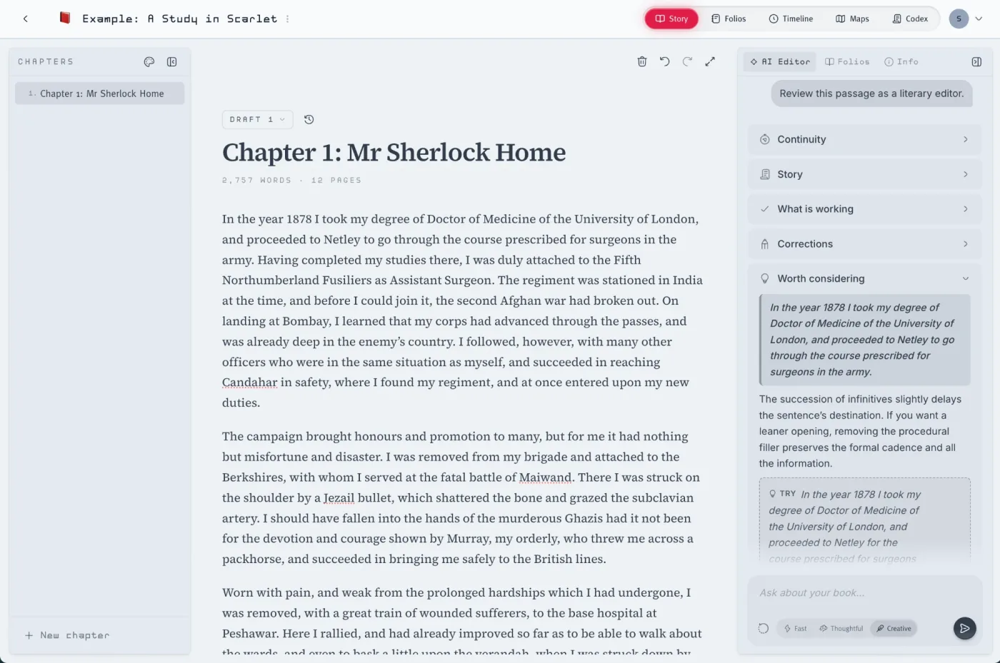
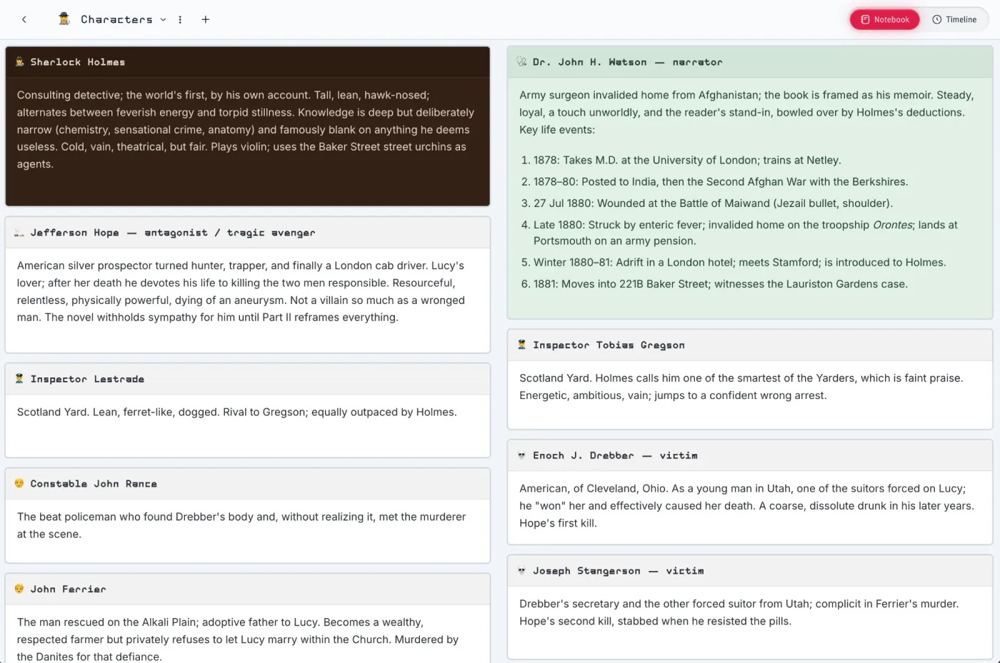
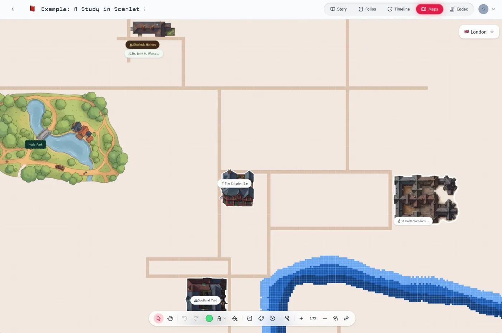

<div align="center">


# Story<i>Mode</i>

<sub><code>community edition</code></sub>

**A calm place to write your story.**<br>
Chapter drafts with an AI editor in the margin, folios of notes, timelines,
illustrated maps and a codex that keeps up with your book.

[](LICENSE.md)
[](#-set-it-up-in-about-10-minutes)
[](https://openrouter.ai)
[](https://nodejs.org)

<br>



</div>

This is the community edition of [StoryMode](https://storymode.waldenpond.net),
for running your own copy with your own AI key. It's free for you to host; the
[hosted version](https://storymode.waldenpond.net) is there if you'd rather not.

## 📑 Contents

- [✨ What's inside](#-whats-inside)
- [🚀 Set it up in about 10 minutes](#-set-it-up-in-about-10-minutes)
- [🔑 Where to find each key](#-where-to-find-each-key)
- [🧱 How it fits together](#-how-it-fits-together)
- [👥 Who can sign up](#-who-can-sign-up)
- [🔄 Updating](#-updating)
- [🛟 If something's not working](#-if-somethings-not-working)
- [💡 Good to know](#-good-to-know)
- [💬 Feedback and bugs](#-feedback-and-bugs)
- [📜 License](#-license)
- [🤝 Contributing](#-contributing)

## ✨ What's inside

| | |
|---|---|
| ✍️ **Chapters and drafts** | A quiet editor, several drafts of each chapter, and export. |
| 🤖 **AI Editor** | Ask about your chapter in the margin: feedback, continuity checks, ideas. Fast, Thoughtful or Creative. |
| 🗂️ **Folios** | Boards of notebooks for characters, places, factions and events, linked to your chapters. |
| 🗺️ **Maps** | Paint terrain, place your notebooks, and draw illustrated stickers with AI Draw. |
| ⏳ **Timelines** | Lay out what happens when. |
| 📖 **Codex** | A reference for your world that keeps up with what you write. |
| 🕵️ **An example to explore** | Every new account starts with *A Study in Scarlet*: a chapter, folios, notebooks and a map of London. |

<table>
  <tr>
    <td width="50%"></td>
    <td width="50%"></td>
  </tr>
  <tr>
    <td align="center"><sub>🗂️ A folio of characters</sub></td>
    <td align="center"><sub>🗺️ London, with AI-drawn stickers and pinned notebooks</sub></td>
  </tr>
</table>

## 🚀 Set it up in about 10 minutes

You'll need [Node.js 18 or newer](https://nodejs.org), plus free accounts with:

| | Service | What it does for StoryMode |
|---|---|---|
| 🟢 | [Supabase](https://supabase.com) | Database, sign-in, file storage and server functions |
| 🟣 | [OpenRouter](https://openrouter.ai) | One key for every AI model: Google, OpenAI and Claude |
| ▲ | [Vercel](https://vercel.com) | Hosts the website |
| ✉️ | [Resend](https://resend.com) *(only if other writers sign up themselves)* | Sends their confirmation and password emails |

The setup wizard helps you create any you don't have yet. Then:

```sh
git clone https://github.com/sakhnenko/storymode-community.git storymode
cd storymode
npm run setup
```

It walks you through nine steps and checks each answer before moving on:

<p align="center">
  
</p>

1. **Check your computer**: Node.js, npx, git and your internet connection.
2. **Supabase**: checks your access token, lets you pick your project (and waits while a new one starts up), and checks your database password.
3. **OpenRouter**: checks your key and warns you if there's no credit yet.
4. **Set up the database**: tables, storage and security rules.
5. **Deploy the server functions.**
6. **Save your AI key on Supabase**, where only the server can read it.
7. **Deploy the web app** with the Vercel CLI (it signs you in through your browser), or gives you the two values to deploy it anywhere.
8. **Point sign-in at your site**, so sign-up emails link to it.
9. **Who can sign up**: just you, people you add, or anyone you open sign-ups to. Only the last one needs Resend ([more below](#-who-can-sign-up)).

> [!TIP]
> Your secrets are never shown as you type and never saved on your computer.
> If you stop halfway, run `npm run setup` again: it picks up where you left off.

When it's done, open your site and sign up. **The first account becomes the
admin.** If you chose *Just me*, sign up with the email you use for
supabase.com, and pick a new password just for StoryMode.

<details>
<summary>▲ <b>Prefer the Vercel button?</b></summary>

<br>

Run `npm run setup` and choose **I'll deploy it myself** when it asks; it
prints the two values. Then:

[](https://vercel.com/new/clone?repository-url=https%3A%2F%2Fgithub.com%2Fsakhnenko%2Fstorymode-community&env=VITE_SUPABASE_URL,VITE_SUPABASE_PUBLISHABLE_KEY&envDescription=Both%20values%20are%20printed%20by%20npm%20run%20setup&project-name=storymode&repository-name=storymode)

Paste the values, deploy, and give the wizard your site's address.

</details>

## 🔑 Where to find each key

The wizard opens these pages for you, but in case you want them:

| What | Where |
|---|---|
| 🟢 Supabase project | [database.new](https://database.new). Supabase asks you to create an organization first if you don't have one; Free is fine. Keep the **database password** you set. |
| 🟢 Supabase access token | [Account → Access Tokens](https://supabase.com/dashboard/account/tokens): your organization, **7 days**, **Full access**. Only setup and updates use it; revoke it afterwards if you like. |
| 🟣 OpenRouter credit | [Settings → Credits](https://openrouter.ai/settings/credits), or your own OpenAI / Anthropic / Google key under [Settings → Integrations](https://openrouter.ai/settings/integrations). |
| 🟣 OpenRouter key | [Settings → Keys](https://openrouter.ai/settings/keys) → **Create Key**, with **no expiration** (StoryMode uses it for every AI request). Starts with `sk-or-`. A monthly credit limit on it is a good idea. |
| ✉️ Resend key *(only for open sign-ups)* | [resend.com/api-keys](https://resend.com/api-keys). To email anyone, verify a domain under [Domains](https://resend.com/domains) first. |

## 🧱 How it fits together

```
  writers ──▶ Vercel                the web app
                │
                ▼
              Supabase
                ├─ Postgres         projects, chapters, notes, maps
                ├─ Auth             sign-in ──▶ Resend (emails)
                ├─ Storage          map stickers and pictures
                └─ Edge Functions   AI requests ──▶ OpenRouter
                                                      ├─ Google
                                                      ├─ OpenAI
                                                      └─ Claude
```

Your writing lives in your own Supabase project. AI requests go from your
server functions to OpenRouter with your key, which never reaches the browser.

## 👥 Who can sign up

Everyone with an account can use AI on your OpenRouter credit, so **sign-ups
start closed**. The first account (you, the admin) can always sign up. After
that, only the addresses you add in **Admin → Sign-ups** can, until you switch
it to **Anyone**.

Your choice also decides whether you need an email service, since Supabase's
built-in email only reaches the address you use for supabase.com:

| Who will use it | Email | How people join |
|---|---|---|
| 🧑 **Just me** | Supabase's built-in email | Sign up with your Supabase account's email. |
| 👥 **Me and a few people I add** | None: accounts work without confirming | Add their address in **Admin → Sign-ups**; they sign up on your site. Nobody can reset a forgotten password. |
| 🌍 **Anyone I open sign-ups to** | [Resend](https://resend.com) | Switch **Admin → Sign-ups** to **Anyone** when you're ready. |

The setup wizard asks which one. To change your mind later, run `npm run setup`,
choose **Start over**, and pick another option at the last step.

## 🔄 Updating

```sh
npm run setup
```

Choose **Update to the latest version**. It gets the latest version from
GitHub, applies any database changes, redeploys the server functions and, if
setup deployed your site, redeploys that too. Have your Supabase access token
and database password ready: setup never saves them.

## 🛟 If something's not working

<details>
<summary>📭 <b>I signed up but nothing happened</b></summary>

<br>

Supabase asks new accounts to confirm their email: look for the confirmation
link in your inbox (and spam). Clicking it signs you in. If nothing arrives,
**Supabase → Logs → Auth** says why. Usually it's either an address
Supabase's built-in email can't reach (see [Who can sign up](#-who-can-sign-up)),
or the sender address in **Authentication → Emails → SMTP Settings**.

</details>

<details>
<summary>🚪 <b>"Sign-ups are closed"</b></summary>

<br>

Sign-ups start closed, so only the admin and the addresses added in
**Admin → Sign-ups** can create an account. Add the address there, or switch it
to **Anyone**.

</details>

<details>
<summary>💳 <b>"Out of AI credits"</b></summary>

<br>

OpenRouter turned the request down for lack of credit. Either add credit at
[Settings → Credits](https://openrouter.ai/settings/credits), or, if you've
added your own provider key in OpenRouter, open **Admin → AI models** in
StoryMode and pick that provider for each tier. **Check** shows whether your
own key is being used.

</details>

<details>
<summary>✉️ <b>Sign-up emails don't arrive</b></summary>

<br>

Resend only sends from a domain you've verified there, or from
`onboarding@resend.dev`, which only reaches the address your Resend account
uses. A personal address like `you@gmail.com` can't be the sender.

</details>

<details>
<summary>😴 <b>My projects stopped loading after a quiet week</b></summary>

<br>

Supabase pauses free projects after a week without use. Open your Supabase
dashboard to wake it up.

</details>

## 💡 Good to know

- 📬 **Email.** Supabase's built-in email only reaches people on your Supabase
  team, a couple of messages an hour. That's enough for you; for anyone else,
  see [Who can sign up](#-who-can-sign-up).
- 🧠 **AI models and your own keys.** In **Admin → AI models** you choose which
  provider serves each tier (Fast, Thoughtful, Creative and Images): Google,
  OpenAI or Claude. If you've added that provider's key in OpenRouter, it's
  used; otherwise requests come out of your OpenRouter credit. The prompts were
  tuned on GPT and Gemini, so Claude's answers may read a little differently.
- 💸 **Costs.** Supabase and Vercel are free for personal use. AI is
  pay-as-you-go with OpenRouter (or your provider).
- ⏱️ **Free plan limits.** Very long Creative reviews can hit the free plan's
  150-second function limit.
- 💻 **Running it on your computer.** Setup writes a `.env`, so after
  `npx bun install` you can run `npm run dev`.
- 🆓 **No plans or payments.** The community edition runs in self-hosted mode:
  no plans, credits or payments, AI for every signed-in user and not metered
  (you pay your AI provider directly), open sign-up, and the app opens
  straight to your projects.

## 💬 Feedback and bugs

| | Where |
|---|---|
| 🐞 **Something's broken** | [Report a bug](https://github.com/sakhnenko/storymode-community/issues/new?template=bug_report.yml). The form asks for what's needed to track it down. |
| 💡 **Ideas and feedback** | [Ideas](https://github.com/sakhnenko/storymode-community/discussions/categories/ideas) in Discussions. |
| 🙋 **Stuck setting up** | [Q&A](https://github.com/sakhnenko/storymode-community/discussions/categories/q-a) in Discussions, where other writers can help too. |
| 🔒 **A security problem** | [Report it privately](https://github.com/sakhnenko/storymode-community/security/advisories/new), not in public. See [SECURITY.md](SECURITY.md). |

Everything is read, though StoryMode is made by one person, so there's no
promise of a reply or a fix date. Never post keys, tokens or passwords: issues
and discussions are public.

## 📜 License

[Functional Source License 1.1, Apache 2.0 future license](LICENSE.md). You can
use, modify and self-host StoryMode for any purpose except offering it as a
competing product or service. Each release becomes Apache 2.0 two years after
it's published.

"StoryMode" and its logo are trademarks: forks need their own name.

## 🤝 Contributing

This repository doesn't accept pull requests; see [CONTRIBUTING.md](CONTRIBUTING.md).
Bug reports and ideas are welcome (see [above](#-feedback-and-bugs)), and so
are forks.
